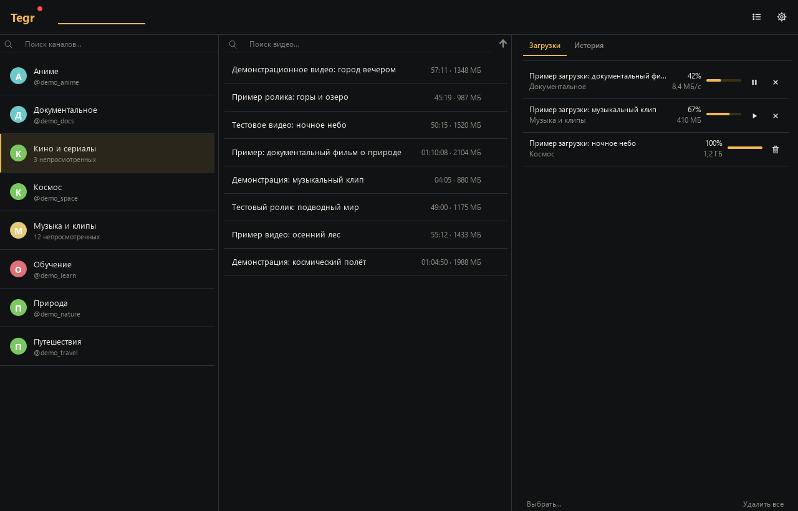
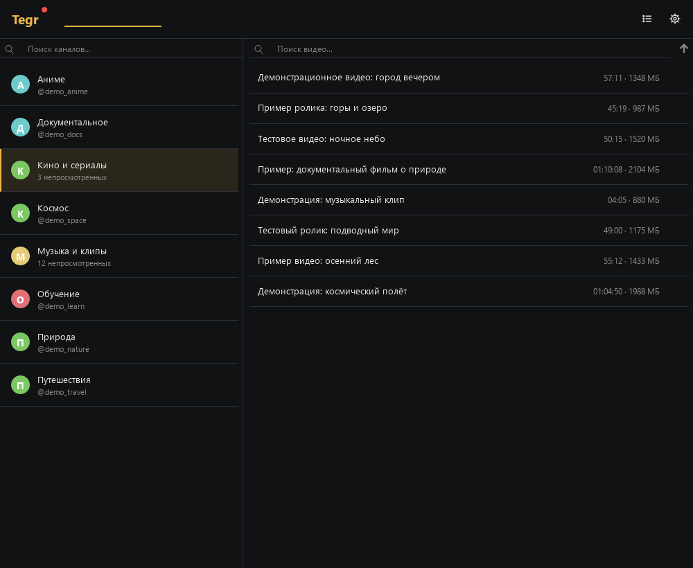
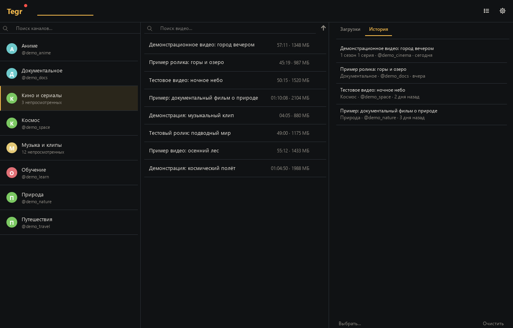
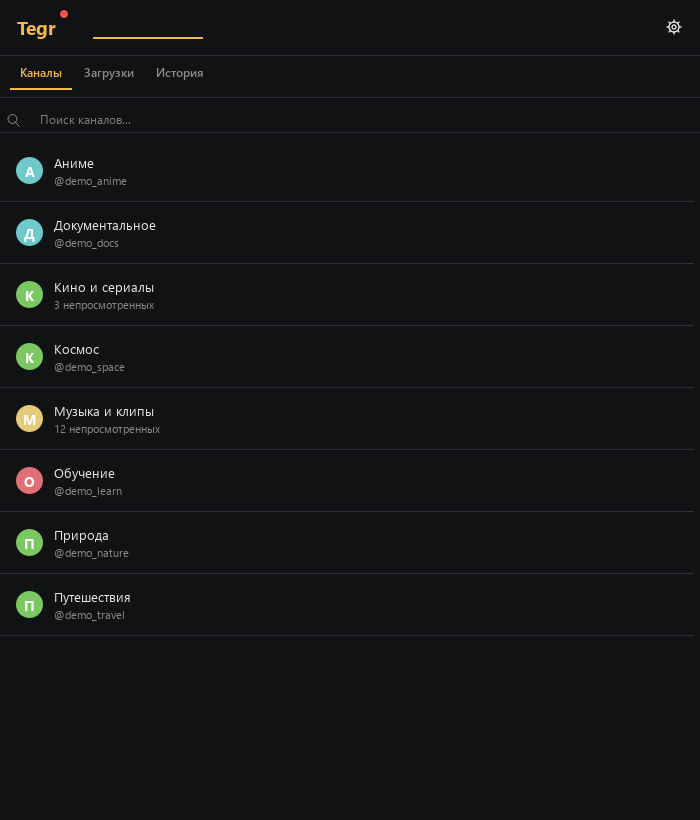
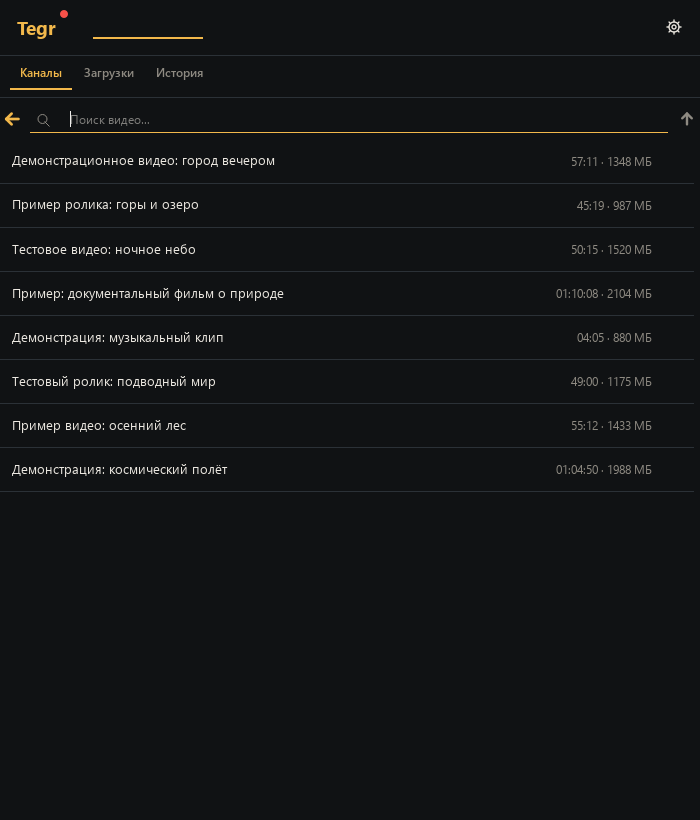

# Tegr

Плеер видео из Telegram для Windows: каналы и папки, потоковое воспроизведение, кэш и загрузки, история просмотров — в одном приложении.

Tegr не ждёт полной загрузки ролика: видео идёт через локальный кэш, поэтому начинается быстро, перемотка работает сразу, а просмотренное остаётся на диске.

## Скриншоты











## Интерфейс

- Широкое окно: три колонки — каналы, видео, история и загрузки.
- Среднее окно: каналы и видео; история и загрузки открываются плавающим окном.
- Узкое окно: одна колонка с вкладками «Каналы», «История», «Загрузки».
- Плоское оформление: единый фон, тонкие разделители, акцентные подсветки.
- Статус подключения — точка у надписи Tegr: зелёная 🟢 (подключение установлено), жёлтая 🟡 (подключается) или красная 🔴 (не удалось подключиться).

## Возможности

- Каналы, группы и папки Telegram; поиск видео по каналу.
- Воспроизведение через libmpv: перемотка, пауза, скорость, PiP, полный экран, горячие клавиши.
- Кэш и загрузки: докачка, пауза, удаление, ручное скачивание.
- История просмотров: название, канал, позиция и дата; переход к ролику на канале.
- Вход по QR или номеру, поддержка 2FA.
- Системный прокси, MTProxy или свой прокси.
- Тёмная и светлая темы, масштаб интерфейса.
- Проверка и установка обновлений из самого плеера.

## Установка

1. Скачайте `Tegr_Setup.exe` из [последнего релиза](https://github.com/yolorik/tegr/releases/latest).
2. Запустите установщик. Windows 10/11, x64.

Обновления также приходят из самого плеера.

## Запуск из исходников

```bash
pip install -r requirements.txt
python player_tegr.py
```

Нужны Python 3.11 и `libmpv-2.dll` рядом с `player_tegr.py`.

## Тесты

```bash
python -m unittest discover -s tests -v
```

## Технологии

Python, PyQt6, libmpv, Telethon, aiohttp.

## Структура проекта

- `player_tegr.py` — точка входа.
- `tgplayer_runtime.py` — общая среда запуска и совместимость.
- `tgplayer/backend/` — Telegram, кэш и локальный HTTP-сервер:
  - `backend.py` — сборка бэкенда и сигналы Qt;
  - `connection.py` — клиент, прокси и переподключение;
  - `login.py` — вход в аккаунт;
  - `catalog.py` — каналы, папки и поиск;
  - `videos.py` — списки видео и качества;
  - `cache.py` — записи кэша и наблюдатель;
  - `download.py` — очередь и загрузка кусков;
  - `stream.py` — HTTP-сервер для mpv;
  - `playback.py` — история и позиции;
  - `cache_math.py`, `http_range.py` — чистые расчёты.
- `tgplayer/core/` — настройки, история, темы, конфигурация, обновления.
- `tgplayer/player/` — окно плеера и управление mpv.
- `tgplayer/widgets/` — общие виджеты.
- `tgplayer/windows/` — главное окно, настройки и строки списков.
- `tgplayer/system/` — запуск Telethon и mpv.
- `tests/` — тесты.
- `installer/` — Inno Setup.
- `_build.ps1`, `_build_inst.ps1` — сборка программы и установщика.

## Сборка

Нужны Python 3.11, зависимости из `requirements-dev.txt`, PyInstaller и Inno Setup 6:

- `_build.ps1` — сборка `Tegr.exe` в `dist\Tegr`;
- `_build_inst.ps1` — сборка установщика в `releases\<версия>`.

---

Неофициальный клиент, не связан с Telegram.
